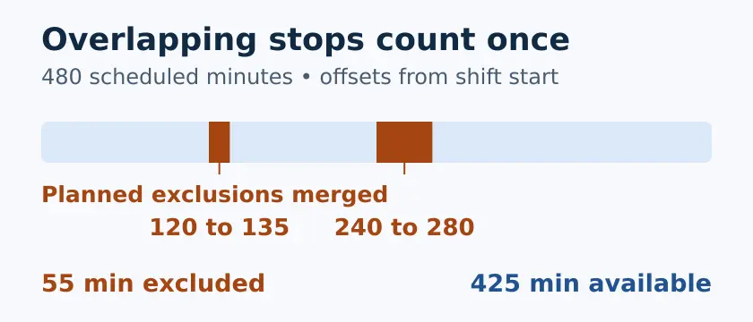
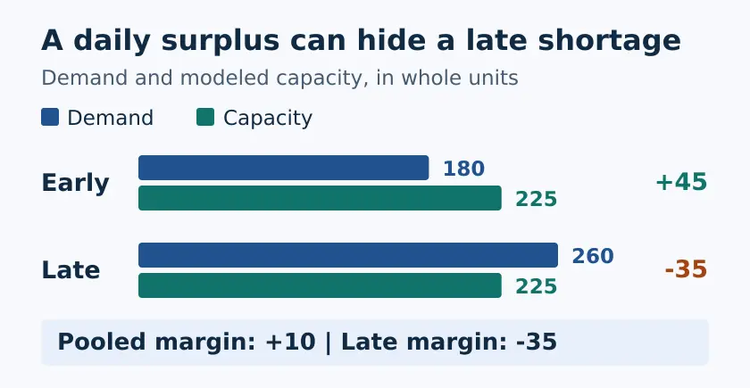

# Automation Takt Time in Python

Calculate how fast a line needs to produce to meet demand, then see what a fixed output cycle could finish in each available production block. The examples are synthetic. This calculator does not talk to a machine.

[Read the full WIFA Robotics tutorial](https://wifarobotics.com/learn/automation-takt-time-calculation/)

## Start from zero

1. Install a supported [Python release](https://www.python.org/downloads/). The project requires Python 3.11 or newer and uses only the standard library. Run `python3 --version` on macOS or Linux. On Windows run `py -3 --version` and replace `python3` with `py -3` in the commands below.
2. On GitHub select **Code**, then **Download ZIP**. Extract it. Open a terminal in the extracted directory containing `takt.py`. If you have Git, you can instead run `git clone https://github.com/williamfarokhzad/wifa-automation-takt-time-calculation.git` and enter the new directory.
3. Run the examples and tests. There is nothing to install with pip.

```sh
python3 takt.py examples/overlapping-stops.json
python3 takt.py examples/shift-surge.json
python3 takt.py examples/short-blocks.json
python3 takt.py examples/no-orders.json
python3 -m unittest discover -s tests -v
```

| Example | Expected result |
| --- | --- |
| Overlapping stops | Day shift: 25,500 available seconds, 56.67 seconds per unit, capacity 462, margin +12 |
| Shift surge | Pooled margin +10; late shift margin −35 and takt 51.92 seconds per unit |
| Short blocks | Takt 90.00 seconds per unit, yet the 70 second cycle cannot finish a unit in any block |
| No orders | Takt is n/a; 80 units of modeled capacity does not imply production is needed |

The invalid example `python3 takt.py examples/invalid-interval.json` exits with code 2 and prints the interval rule. A valid plan with a shortfall exits with code 0 because the calculation succeeded.

## Enter a plan

```json
{
  "cycle_s": 50,
  "windows": [
    {
      "name": "Pilot shift",
      "scheduled_min": 60,
      "demand": 60,
      "exclusions_min": [[15, 20], [18, 23]]
    }
  ]
}
```

Save this as `plan.json` and run `python3 takt.py plan.json`. The two stops cover minutes 15 through 23 together, so net time is 3,120 seconds and takt is 52.00 seconds per unit. The two blocks yield 18 and 44 modeled completions, respectively. Capacity is 62 and margin is +2.

Use whole seconds for a positive output cycle. Each window is a separate, nonoverlapping production window on the same line. Use whole minutes for the scheduled duration and the start and end of planned exclusions. Each exclusion is relative to the window start and includes its first minute but not its ending boundary. Demand is a whole count of good units due within that window. Window names must be unique. Explicitly enter an empty list when there are no planned exclusions.

The calculator subtracts the union of the exclusions. Takt is net available seconds divided by demand, or n/a if demand is zero. To screen capacity it counts only whole cycles inside each uninterrupted block, then sums the counts. A positive pooled margin does not prove that every window can meet its own deadline. Compare the individual rows. Decide separately whether early stock can cover later demand.

## Troubleshooting

- **File not found:** check the extracted directory and use quotes around paths with spaces.
- **JSON error:** use double quotes, remove trailing commas, and check for duplicate keys.
- **Time looks too short:** enter offsets in minutes, `cycle_s` in seconds, and demand for exactly the same window as the schedule. Include agreed planned stops once; leave unplanned downtime out of the takt calculation.
- **Cycle meets takt, but blocks fall short:** inspect the contiguous run durations. The model resets at planned stops. If work can safely resume after a stop, use a model that carries unfinished work rather than treating this estimate as an observed limit.

## Diagrams and scope





The diagrams are generated from the included examples. Editable SVGs are in `diagrams/`. To regenerate the WebPs, install Inkscape, ImageMagick and DejaVu Sans, then run `python3 diagrams/render.py`. Those tools are optional for the calculator and tests.

One constant cycle, one good unit per completed cycle, no overlap or carry of partial work across stops or windows, no measured loss or quality model. Do not use this model as a machine speed setting or a capacity commitment. For real planning, collect consecutive good output timestamps, downtime and rejects, and check the approved limits for the actual line.

Definitions: [Lean Enterprise Institute: takt time](https://www.lean.org/lexicon-terms/takt-time/), [cycle time](https://www.lean.org/lexicon-terms/cycle-time/), and [Toyota Production System](https://global.toyota/en/company/vision-and-philosophy/production-system/).
